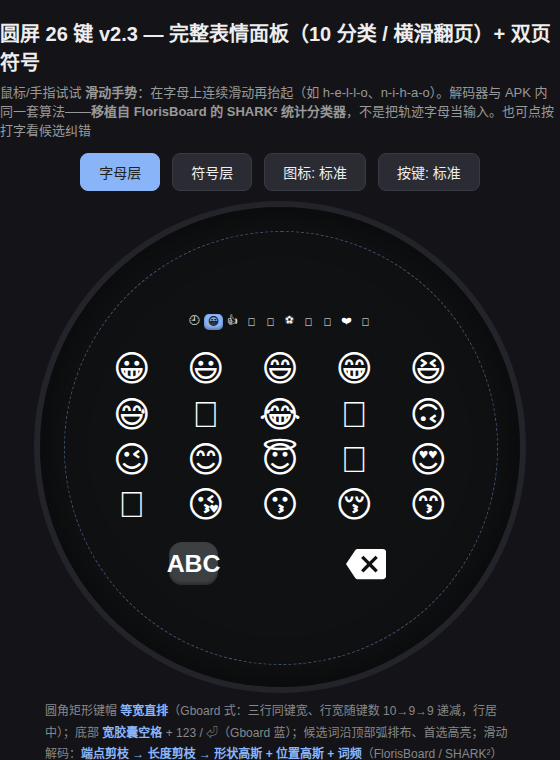

# 圆屏 26 键输入法（Wear OS / Kotlin）

为 **Wear OS 圆形表盘** 专门设计的 26 键 QWERTY 输入法（Kotlin）。
参考 **Gboard for Wear OS** 的设计语言：圆角矩形键帽沿表盘**同心圆弧**排布、
宽胶囊空格、Gboard 蓝功能键，并带有**双重边距限制**，任何分辨率圆屏下都不贴边、不被表盘裁切。



## 特性

| 特性 | 说明 |
|---|---|
| Gboard 直排布局 | 三排按键**水平直线**（Gboard for Wear OS 式），行宽按「该行高度处圆弧弦长 × 0.88」截取，两端自然收进圆内；底部**宽胶囊空格** + 123 / ⏎（Gboard 蓝）；候选词顶部横排、首选高亮 |
| 边距限制 ① | 键盘整体留出 `max(10px, 5%×直径)` 的外边距 |
| 边距限制 ② | 任何按键外缘越出「安全圆」（96.5% 内切圆）都会被**自动沿径向拉回** |
| 圆屏触控 | 圆角矩形最近命中 + 手指容差；长按 ⌫ 连续删除；⇧ 单击大写 / 双击锁定（⇪）；123 ⇄ ABC 符号层 |
| **Gboard 等宽布局** | 三行**等宽键**（键宽统一按最宽行 10 键 × 顶部行弦长确定），行居中、行宽随键数自然递减（10→9→9），符合 QWERTY 视觉习惯 |
| **M3 设置页** | 应用内设置页用 **Material 3 (Compose)** 组件库重构：M3 按钮与配色、词库状态、SAF 文件导入；键盘本体保持自绘 View（IME 低延迟标准做法） |
| **滑动输入** | **SHARK² 统计解码**（移植自 FlorisBoard 的 `StatisticalGlideTypingClassifier`，Apache-2.0）：端点剪枝（起/终点各最近 2 键）→ 长度剪枝 → **形状高斯**（按包围盒归一化，与表盘尺寸无关）× **位置高斯** × **词频** 综合置信度排序；重复字母自动生成绕环理想路径区分 pool/poll |
| **智能纠错** | 漏按/错按自动修正：词频优先的前缀匹配 + **1 次编辑距离**（删除/替换/插入）纠错；滑行未命中时自动退化为组合纠错 |
| 自定义词库 | 应用内导入任意 UTF-8 词库文本（英文联想 / 拼音→中文），**导入即生效（应用内更新，无需重装）** |
| 低依赖 | Kotlin + Android 框架 API，无 AndroidX、无其他第三方库 |

## 国内镜像配置（已内置）

| 位置 | 镜像 |
|---|---|
| `settings.gradle` | 阿里云 `maven.aliyun.com`（google / gradle-plugin / public），官方源兜底 |
| `gradle/wrapper/gradle-wrapper.properties` | 腾讯云 `mirrors.cloud.tencent.com/gradle/gradle-8.7-bin.zip` |

## 构建打包

```bash
# 方式一：Android Studio 直接打开工程，Build > Build APK(s)

# 方式二：命令行（需 JDK 17+，SDK 34 + Build-Tools 34.0.0）
./gradlew assembleDebug          # 或 gradle assembleDebug
# 产物：app/build/outputs/apk/debug/app-debug.apk
```

## 安装启用（手表上）

1. `adb install -r app-debug.apk`（或从 `apk/` 目录取现成包）
2. 打开手表上的「圆屏26键输入法」应用，点「去开启输入法」勾选它
3. 在任意输入框长按 → 切换输入法 → 选择「圆屏26键」

## 输入技巧

- **滑动输入**：按住第一个字母 → 连续滑过单词路径 → 抬起，自动匹配整词（需已导入词库）；候选未命中会自动退化为组合纠错
- **点按输入**：字母进入组合串（显示在空格键上），顶部弧出现最多 3 个候选；漏按/错按自动按 1 次编辑距离修正
- **空格** = 上屏首选候选 + 空格；**回车** = 上屏原始字母串；**退格**优先删组合串
- 未导入词库时字母直通上屏（Shift 转大写）

## 调参指南

所有几何参数集中在 `RoundKeyboardView.kt` 顶部 `companion object`：

| 常量 | 含义 | 默认 |
|---|---|---|
| `MARGIN_FRACTION` | 外边距占直径比例 | 0.05 |
| `SAFE_FACTOR` | 安全圆占内切圆比例（越界拉回） | 0.965 |
| `HIT_SLOP_MUL / HIT_SLOP_ADD` | 触点容错 | 1.15 / 8px |
| `GESTURE_START / GESTURE_MIN_PATH` | 滑行触发位移 / 最短轨迹 | 0.30R / 0.85R |
| `addArcRow(...)` 的 `y0f/curvef/spanF` | 各行纵向位置 / 弧度 / 行宽占比 | 见源码注释 |

## 自定义词库（应用内更新）

打开手表上的「圆屏26键输入法」App → **导入词库**，选择 UTF-8 文本文件（`.txt`）即可，**导入立即生效，随时可重新导入更新，无需重装应用**。

文件格式（每行一条，可参考仓库内 `sample_dict.txt`）：

| 写法 | 示例 | 效果 |
|---|---|---|
| 单词一行 | `hello` | 输入 `hel` / 滑动联想 hello |
| 键 值（空格分隔） | `nihao 你好` | 输入/滑行 `nihao` 候选「你好」 |
| 键 TAB 值 TAB 词频 | `nihao<TAB>你好<TAB>500` | 词频越大候选越靠前 |
| 注释 | `# 注释` | 忽略 |

### 词库工作原理

`WordStore` 把词库解析为 `(key, value, freq)`，按 key 排序后二分查找做前缀匹配（单次扫描上限 500 条，总词条上限 20 万）；
滑动解码分四步（`GlideDecoder.kt`）：① 采样抽稀 ② 端点剪枝：手势起/终点各取最近 2 键，命中 (首键,尾键) 词树（索引在 `WordStore` 预建）③ 长度剪枝：理想路径长度与手势长度差 > 14×键半径 的词丢弃（为圆屏小键与拼音长词放宽，剪空则回退）④ 打分：形状距离（归一化）/位置距离（L1）套高斯概率，乘对数归一化词频，confidence 越小越优。

## 目录结构

```
app/src/main/java/com/example/roundkb/
├── RoundKeyboardView.kt   # 核心：Gboard 风格圆弧布局 + 边距限制 + 纠错 + 滑行手势 + 绘制
├── WordStore.kt           # 自定义词库：解析 / 二分前缀匹配 / 手势词过滤 / 应用内导入更新
├── RoundIME.kt            # InputMethodService，接 InputConnection
└── MainActivity.kt        # 启用引导 + 词库导入 / 清空 / 统计
```

## 致谢

- [FlorisBoard](https://github.com/florisboard/florisboard)（Apache-2.0）—— `GlideDecoder.kt` 移植自其 `StatisticalGlideTypingClassifier`
- [AnySoftKeyboard PR #1870](https://github.com/AnySoftKeyboard/AnySoftKeyboard/pull/1870)（Étienne Desticourt）—— 上述实现的源头
- SHARK²：Kristensson & Zhai 的 shapewriter-on-keyboard 算法
- [Material Symbols / Material Icons](https://fonts.google.com/icons)（Apache-2.0）—— 键盘功能键与应用图标的矢量图形

## 更新日志

- **v2.3**：新增**完整表情面板**——10 分类页签（最近/笑脸/手势/动物/食物/活动/旅行/物品/符号/旗帜）、内置约 1065 个常用 Emoji（Unicode 15 常用面，离线可用），5×4 网格 + **横滑翻页** + 页码圆点，点按直接上屏并自动记入「最近」；工具条新增 😀 键；符号层扩为 **?123 / =\\< 两页**，完整覆盖阿拉伯数字、标点、括号、货币（￥$€£₩）、数学（±×÷≈°）等符号；修复表情页签与工具条重叠

- **v2.2**：**Gboard Wear 真机还原**（对照实机截图重排）——顶部工具条（‹ 切换输入法 / ?123 符号 / ↵ 回车 / ✕ 收起，组合时替换为候选条）、三行小写字母键改为**无键帽**（纯文字印在黑底，Gboard Wear 真机式）、底排改为 ⇧ / 宽空格 / ⌫ 三键；设置项全部改为**连续滑块**（按键大小 0.8~1.2×、图标大小 0.6~1.6×、震动振幅 0~100%，松手试震），并加入**实时键盘预览条**

- **v2.1**：新增**按键大小**全局设置（小 0.9 / 标准 1.0 / 大 1.1）——字母键、功能键、空格、候选胶囊整体缩放，越界自动拉回；IME 在 `onStartInput` 时重排，改完设置重新呼出键盘即生效

- **v2.0**：功能键图标默认调小（键短边 1.10→0.95 基准）；新增**全局图标大小**设置（小/标准/大，即时生效）；新增**按键震动自定义**（关/弱/中/强，`VibrationEffect` 分档时长与振幅，滑行无命中等提示固定用强档）；设置页改为可滚动并加入 M3 FilterChip 选择器

- **v1.9**：**Gboard Wear 式紧凑填满布局**——四行（3 字母行 + 控制行）行距统一 0.25R 紧凑堆叠，纵向撑满圆盘中带（顶行 -0.42R、控制行 +0.40R），消灭大片行间隙；键帽回到近方形略高（Gboard Wear 式饱满键帽），键间隙仅 4% 步距；大空格键与 123/⏎ 同行紧跟字母区

- **v1.8**：键帽改为**横向扁宽长方形**（宽:高 ≈ 1.27:1，此前 v1.7 只是近方形），键距再外扩（ROW_SPAN 0.94、顶行 0.40R），行距收紧、字母字号放大补偿

- **v1.7**：**加宽键盘字母键**——键距（ROW_SPAN 0.88→0.93）与顶行位置（0.44R→0.42R）外扩，键帽高比 0.60→0.52 改为近方形观感，字母字号相应放大；安全圆余量 3.5%→2%

- **v1.6**：抛弃自绘/Unicode 字符图标，全面改用 **Material Icons 图标库**矢量资源：功能键（Shift=capslock、退格=backspace、回车=keyboard_return、空格=space_bar）、应用启动图标（Adaptive Icon，键盘图标 + Gboard 蓝）、设置页按钮图标（settings / upload / delete）

- **v1.5**：布局改为 **Gboard 等宽键**（行宽随键数 10→9→9 递减，修复第一行反而最短的问题）；设置页引入 **Material 3 (Compose)** 组件库重构；APK 增大至 ~7.6MB（Compose 运行时）

- **v1.4**：滑动输入整体替换为 **SHARK² 统计解码**（移植 FlorisBoard，端点/长度剪枝 + 形状/位置高斯 + 词频），离线模拟命中率 top1 93%；新增 `GlideDecoder.kt`，词库增加端点索引

- **v1.3**：行排布改为 **Gboard 式水平直排**（不再弧形弯曲）；滑动输入算法升级（子序列校验 + 双向 Chamfer + 字母必经性 + 词频加成），轨迹字母不再被直接当词用
- **v1.2**：全面改用 **Kotlin**；Gboard 风格重构（圆角键帽 / 宽胶囊空格 / 蓝色功能键 / 顶部候选弧）；新增**滑动手势输入**与**1 次编辑纠错**
- **v1.1**：自定义词库（应用内导入/清空/统计，导入即生效）、组合输入
- **v1.0**：圆弧排布 26 键、双重边距限制、Shift/大写锁定、符号层、长按退格
